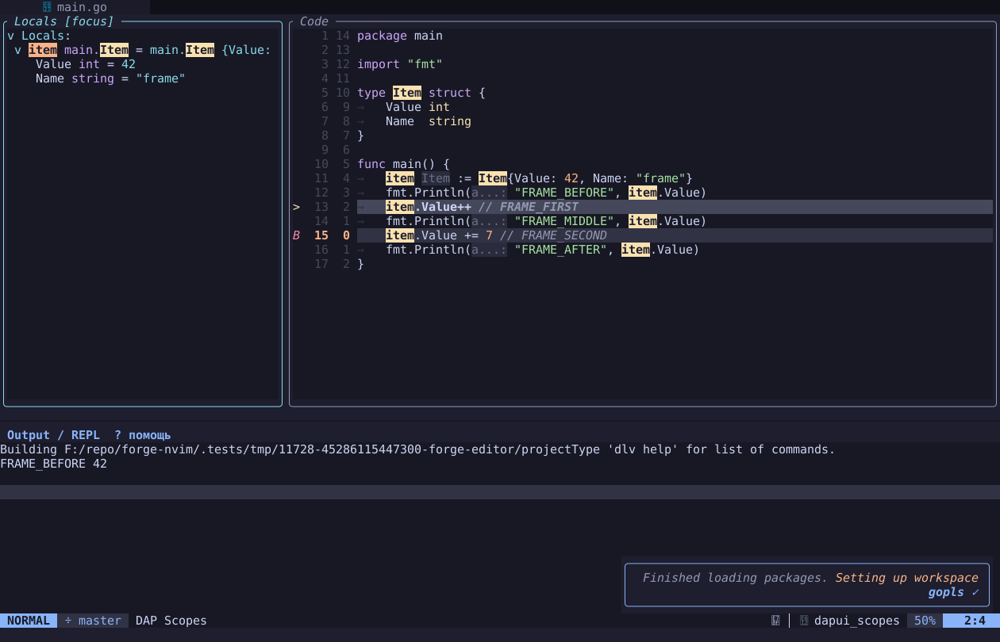

# Рабочий пилот рамок Code / Locals

IDE-076, 2026-11-11. Это следующий шаг после [визуального образца](PANEL_FRAME_REVIEW.md):
два настоящих рабочих окна с рамками, без source-окна Locals под копией.

В остановленной отладке, при одной группе кода, выполните `:ForgeFramePilot`.
Повторная команда возвращает обычную раскладку. Слева остаётся только Locals;
Watch, Stack и Breakpoints доступны после выхода из пилота. Output остаётся
в штатной нижней панели. Новых зависимостей и настройки для установки нет.



Сохраняются `Enter` для раскрытия переменных, `F10`/`F5`, `Space w h/j/k/l`,
`Space w 0/d/c`, `q`, `Space w z`, `?` и `Esc`. Zoom меняет размер того же
окна Locals. Активная рамка получает цвет DiagnosticInfo, остальные — Comment
из текущей темы. При скрытии Locals код занимает освободившееся место.

Размеры берутся из области кода, поэтому рамки не закрывают Output. Если
область становится меньше 64×8, пилот выключается с коротким сообщением.
Переход в другой tab и подготовка session save также возвращают обычные окна;
файлы, их правки, DAP-сессия и история Output сохраняются. Открытие native
DAP sidebar выходит из пилота. Для скрытия pilot Locals используйте `q`;
`dapui.close(layout=1)` управляет только штатным layout плагина.

## Что проверено

`tests/e2e/frame-layout.test.lua` запускает настоящий Forge, Go и Delve через
UI/RPC. Переменная раскрывается штатным Enter, меняется42→43 после F10,
следующий F5 выбирает вторую строку breakpoint, stdout заканчивается
`FRAME_AFTER 50`. Есть resize140×45→100×35→60×22, native sidebar, hide/reopen,
помощь, zoom без второго окна Locals, сохранение правок при отключённом
публичным ASToggle autosave, tab exit и session save/restore.

RGB grid проверяет четыре угла и цвет рамки; 400мс idle не вызывает layout
цикл. Это наблюдение одного fixture, не benchmark производительности IDE.
Подробные размеры и время первого включения —
[evidence](assets/panel-frames/pilot-evidence.json).

```powershell
& .tools/neovim/windows-x64/bin/nvim.exe -l tests/e2e/frame-layout.test.lua
docker compose -f tests/containers/compose.yaml -f tests/containers/limits.yaml run --rm --no-deps --pull never --entrypoint nvim ubuntu -l tests/e2e/frame-layout.test.lua
```

```sh
nvim -l tests/e2e/frame-layout.test.lua
```

Editor/DAP test SDK готовится отдельно по [E2E README](../tests/e2e/README.md).
Mac, физические клавиши и pixel/font QA WezTerm ещё не проверены. Обычная раскладка по умолчанию
прежняя; все панели этим пилотом не покрыты.

Дополнение §186: `nvim -l tests/diagnostics/wezterm-frame.lua` из уже
запущенного Windows WezTerm открывает собственное тестовое окно через CLI.
Нужны готовые Editor/Go/Delve SDK и Node. Новый pane ID проверяется по cwd;
CLI ввод проходит PTY → native remote TUI → Forge. Проверены Locals42→43,
VT F10, направления, помощь/zoom/возврат и реальные текст/ANSI-атрибуты pane.
Физические OS key events и pixel/font QA этим не проверены. В этом probe
две UI: RPC140×45 ограничивает размер native клиента, хотя pane196×65.

## Цена и решение перед распространением

Layout —164 строки общего Lua, плюс небольшие подключения к main/controls/
sidebar/session cleanup. Backend DAP UI и его renderer не менялись; polling,
нового registry, private API и нового плагина нет. Neovim требует одно обычное
окно: здесь оно пустое и служит общей областью для двух рабочих float,
а не хранит скрытую копию каждого инструмента.

При ширине root140 Code/Locals имеют98/38 колонок текста и26 строк внутри
области140×28. Рамки стоят по2 строки и2 столбца на окно; при100×21 —68/28
колонок и19 строк. Это другие пропорции, чем sidebar из четырёх секций;
утверждения об одинаковой рабочей площади или ускорении нет.

Пилот подтвердил возможность живых рамок без backend fork, но потребовал
особого размещения и навигации floating code. Перенос всего IDE означал бы
замену владельца layout и новую проверку открывающих код действий разных
backend. До физической оценки сохраняем opt-in режим и не наращиваем его
панель за панелью рядом с Edgy. Следующий шаг плана — конкретные сокращения
по FEATURE_REVIEW, затем небольшое упрощение существующего управления.
