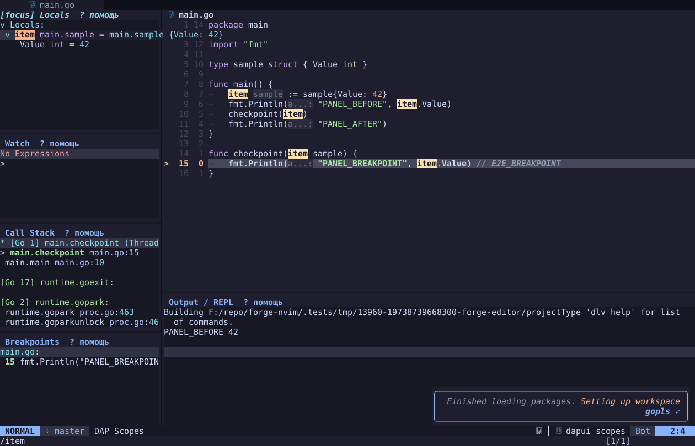
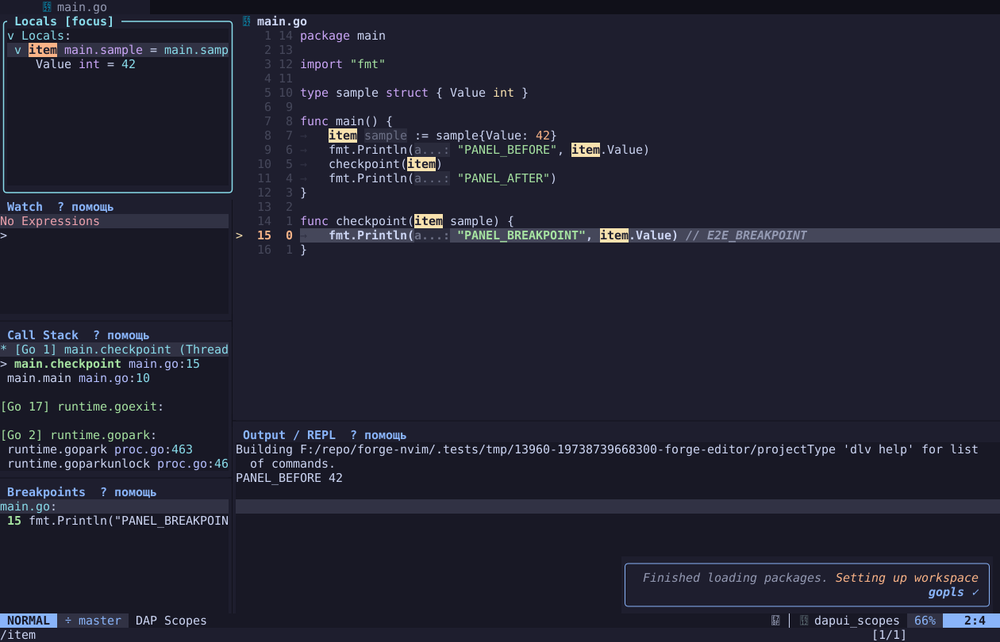
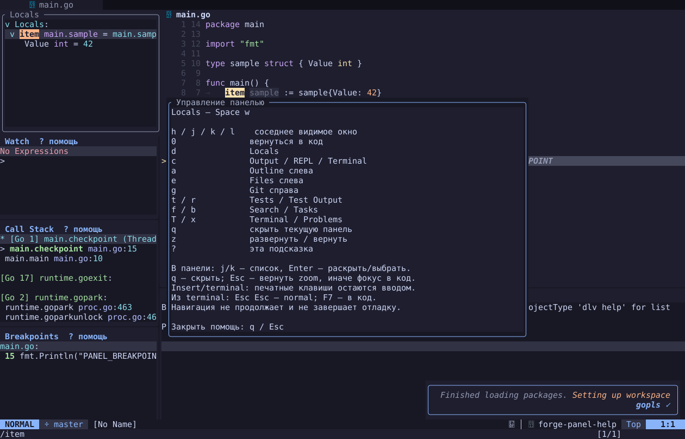

# Цельная цветная рамка: прототип Locals

Следующий рабочий этап: [пилот Code / Locals](PANEL_FRAME_PILOT.md),
`:ForgeFramePilot`. Этот документ сохраняет результаты первого образца zoom.

2026-11-11, IDE-076; история — FIXLOG §173.

Владелец выбрал цельную рамку, цвет и аккуратное оформление Termide.
Под заголовком здесь понимается название `Locals` в верхней линии рамки;
это пояснение прототипа, а не отдельное предпочтение владельца.

## Что уже можно посмотреть

Это настоящая остановка Go/Delve: в Locals раскрыт `item.Value = 42`.
До и после оформления сохранены session/thread/frame, код и stdout;
явный Continue печатает `PANEL_AFTER`. Данные не нарисованы макетом.

Исходная панель:

Компактный образец с фокусом — цельная акцентная рамка:

Фокус перешёл в общую помощь — та же рамка приглушена:

[PNG активного образца](assets/panel-frames/frame-compact.png) ·
[происхождение артефактов](assets/panel-frames/evidence.json).

## Что именно реализовано

Отдельный `tests/diagnostics/panel-frame-preview.lua`, загружаемый только явно,
украшает **существующий zoom Locals**: native rounded border со всех четырёх
сторон, accent/dim из нынешней темы, название в рамке вместо второго winbar.
Тест временно размещает этот overlay над исходным slot для компактного
сравнения. Это **не постоянная рамка обычного split** и не новый менеджер окон.
Stop возвращает старые options/highlights и исходную функцию refresh.
Обычный запуск редактора прототип не загружает.

| Состояние на UI 140×45 | Площадь содержимого | Цена |
|---|---|---|
| Исходный Locals, окно 32×12 с winbar | 32×11 | Текущий baseline |
| Компактный образец, inner 31×11, outer 33×13 | 31×11 | Один столбец текста; рамка занимает winbar/разделитель вокруг slot |
| Исходный zoom, окно 136×40 с winbar | 136×39 | Текущий baseline |
| Тот же zoom с названием в border | 136×40 | Возвращена строка дублирующего winbar |

Геометрия относится к этой фикстуре, не является обещанием для любой раскладки.
Исходный split остаётся под overlay. Для постоянных рамок всех панелей надо
отдельно решить размещение, resize, скрытие и передачу фокуса; накрывать
каждый split дополнительным окном по умолчанию этим шагом не предлагается.

## Почему нельзя просто включить winborder

В выбранном Neovim `winborder` применяется к floating windows. Обычные split
используют разделители, winbar и общую statusline; текущий Edgy требует
`laststatus=3`. Поэтому четыре стороны вокруг каждого split не получаются
одной настройкой. Заголовок с разделителями не выполняет пожелание владельца
о цельной рамке. Следующий шаг — отдельный дизайн постоянного размещения
с оценкой стоимости и regression, затем перенос на остальные панели.

Фактический референс —
[Termide panel_rendering.rs, d701d7b9](https://github.com/termide/termide/blob/d701d7b9244eebe513c3a3d893a44808343b0b65/crates/ui-render/src/panel_rendering.rs):
полный border и accent/bold при фокусе, приглушённый цвет без фокуса.
[Лицензия MIT](https://github.com/termide/termide/blob/d701d7b9244eebe513c3a3d893a44808343b0b65/LICENSE).
Rust-код не переносился; палитра берётся из Forge.

## Найденный баг общей модели, IDE-101

На source2719e39 plain zoom → `?` превращал overlay в обычный split.
Edgy видел знакомый filetype и пристыковывал его; `controls.restore` при этом
не вызывался. Fix помечает только новое окно документированным
`vim.w[win].edgy_disable`; shared buffer и исходный slot остаются обычными.
Закрытие source backend теперь явно возвращает фокус в код; явный выбор
другой панели сохраняется. Это исправление runtime отделено от стиля preview.

## Как проверить и где предел доказательств

[Команды и подготовка](../tests/diagnostics/README.md#цельная-рамка-locals-и-rgb-ui-capture).
Постоянные E2E — `ui-capture.test.lua`, `panel-frame.test.lua` и
IDE-PANEL-18 в `debug-panels.test.lua`. Проверяются реальные RGB-углы всех
четырёх сторон, active/dim, помощь, возврат фокуса, UI resize100×35,
восстановление раскладки и та же DAP pause/stdout. Windows/Ubuntu запускаются
поочерёдно. Native Mac и физический WezTerm GUI остаются открытыми.

Изображения восстановлены из native RGB redraw Neovim, **не являются
скриншотами физического WezTerm**. SVG сохраняет клетки, RGB, bold/italic;
box glyphs экспортированы непрерывными vector strokes. Шрифт/DPI, Nerd icons,
мигание курсора и underline не воспроизводятся полностью. PNG — только
растеризованный просмотр тех же клеток. Эти ограничения не заменяют GUI gate.

IDE-076 остаётся открытым: постоянный стиль обычных панелей ещё не включён.

Следующий шаг разобран отдельно: [варианты постоянных рамок и границы пилота](PANEL_FRAME_DESIGN.md).
