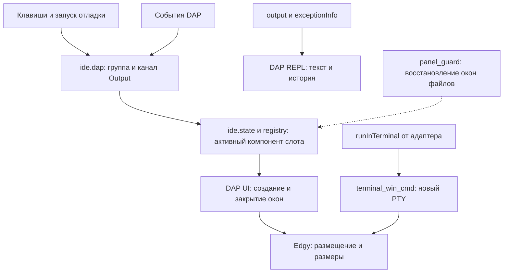

# IDE-080 — ответственность за окна и вывод отладки

2026-11-10. Обзор текущего runtime `d470be5`, без изменения поведения.
Продолжение [общего обзора фич](FEATURE_REVIEW.md). Цель — выбрать, какую
ответственность можно убрать или объединить перед рефакторингом.

## Вывод по слоям

`ide.state`, DAP UI и Edgy выполняют разные задачи. Само наличие трёх слоёв
не доказывает дублирование менеджеров. Удаление любого из них сейчас потребует
переноса его ответственности; ускорение или упрощение от этого не доказано.

Пунктир — вспомогательная проверка окон, а не штатный маршрут каждого показа.
Сохранение вывода, видимость панели и остановка процесса — разные действия.

| Участок | Ответственность сейчас | Что нельзя потерять |
|---|---|---|
| `ide.controls` | Единые focus/direction/zoom/help/действия | `Space w`, ввод в REPL, возврат курсора после zoom |
| `ide.dap` | Debug-группа, секция, фокус и последний канал Output | Скрытие без остановки сессии; возврат нужного вывода |
| `ide.state` / registry | Один активный компонент в слоте, идемпотентный show | Повторный запрос не пересоздаёт уже открытый компонент |
| DAP components в `ide/init.lua` | Связь компонентов с layout 1/2/3 и существующим PTY | Sidebar — четыре физических окна; bottom — один источник |
| `plugins/dap-ui.lua` | Окна scopes/watches/stacks/breakpoints, console и REPL | Автооткрытие DAP UI выключено; события обслуживает общий маршрут |
| `plugins/edgy.lua` | Docking, размеры и размещение окон | Не начинает/завершает debug-сессию |
| `plugins/dap.lua` | Адаптеры, launch/defaults, process/PTY lifecycle, события | Новый PTY для запуска; восстановление панели на pause; очистка один раз перед новым запуском |
| `forge.dap_output` | Exception summary/exceptionInfo в REPL | Текст panic во время паузы; защита от позднего ответа старой сессии |
| `ide.activities` | Закрытие остальных activities, скрытие debug и отдельный stop | Закрытие UI не равно terminate; аргумент `debug` в close_activity — исключение из закрытия |
| `forge.panel_guard` | Файл не остаётся в tool window; repair после session restore | Не оставлять код с tool-local клавишами/winfix и не терять текст |

Основные исходники: [state](../nvim_forge/lua/ide/state.lua),
[DAP UI orchestration](../nvim_forge/lua/ide/dap.lua),
[components](../nvim_forge/lua/ide/init.lua),
[activities](../nvim_forge/lua/ide/activities.lua),
[controls](../nvim_forge/lua/ide/controls.lua),
[DAP](../nvim_forge/lua/plugins/dap.lua),
[exception output](../nvim_forge/lua/forge/dap_output.lua),
[guard](../nvim_forge/lua/forge/panel_guard.lua).

## Что наблюдалось в настоящем редакторе

Поверх неизменённых E2E запущен
[диагностический observer](../tests/diagnostics/trace-panels.lua).
На каждой ОС: debug-panels 4 PASS, dap-output 4 PASS, только default Rust F5
1 PASS. Это 9 сценариев Windows и 9 Ubuntu, не полный Rust/language regression.
Тестовые assertions и production Lua не менялись.

| Набор | События Windows / Ubuntu | `ide.show` | Открытия sidebar / REPL | `dapui.open` |
|---|---|---|---|---|
| debug-panels | 410 / 408 | 14 / 14 | 3:3 / 3:3 | 6 / 6 |
| dap-output | 640 / 650 | 43 / 45 | 3:3 / 3:4 | 6 / 7 |
| Rust default F5 | 98 / 102 | 4 / 4 | 1:0 / 1:0 | 1 / 1 |

Числа — наблюдения одного прогона, не стабильные эталоны и не benchmark.
В output-наборе пять `dap.run` и пять `dap.repl.clear` на каждой ОС:
очистка привязана к новому запуску, а не каждому запросу показа/паузе.
Разница количества show/open между ОС сама по себе не доказывает дефект.
`state.show` проверяет уже открытый компонент перед вызовом open.

В panel-наборе было 28 вызовов controls.restore на каждой ОС. Функция сразу
возвращает false, если zoom отсутствует; это не 28 перестроений layout.
В Rust на каждой ОС native runInTerminal один раз вызвал terminal_window,
а component.dap.terminal.open не вызывался: первый PTY создаёт callback
адаптера, компонент предназначен для повторного показа существующего.
Объединение этих двух путей без проверки жизненного цикла будет опасным.

Артефакты Windows: `.tests/editor-e2e/6913054473300`, `7211555508800`,
`7233218115600`. Ubuntu: `.tests/ubuntu/editor-e2e/6930111478448`,
`6958233808195`, `6981442645497`. В каждом есть panel-trace.json, source observer,
config-source, native snapshots/logs и shutdown.json. Все шесть editor exit=0,
own scopes empty; dropped=0. Проверены raw config sources и неизменность
runtime/lock/E2E. Сводка — `.tests/panel-review-evidence.json`.

Observer подключается после editor.start и только к уже загруженным модулям
или очередному LazyLoad. Ранние/необёрнутые/сохранённые прежде ссылки могут
не попасть в trace. Это ограниченная диагностика public calls, не полная
call graph и не CPU profiler. Она сохраняет return tuple и ошибки реального
API, не подменяет данные сессии. Listener `forge_e2e` — наблюдатель fixture,
его нельзя считать ещё одним production lifecycle manager.

## Конкретные кандидаты на упрощение

1. **Политика канала Output.** При запуске `section_for_config` учитывает
   codelldb, console=integratedTerminal и Go outputMode=remote. Legacy `Dv`
   через `ide.dap.open` выбирает Go/Delve REPL, для остальных — console.
   `Space w c` использует видимый или последний источник. Эти пути не одинаковы.
   Сначала зафиксировать ожидаемый reopen после hide/exit для Go, Rust,
   Python и Node; затем один небольшой resolver для выбора канала. Native
   создание PTY и история REPL должны остаться у своих владельцев. Разница
   исходников пока не объявлена воспроизведённым пользовательским багом.
2. **Поиск окна кода.** state, activities и panel_guard используют разные
   критерии tool/main/orphan. state.find_main_window может создать split/enew;
   поиск окна в activities имеет другие фильтры. Нельзя механически объединить
   списки filetypes или заменить все функции одной: это меняет float/terminal/
   отсутствие main window. Сначала E2E перечисленных состояний, затем общий
   чистый predicate лишь там, где семантика действительно совпадает.
3. **DAP lifecycle.** После первых двух шагов вынести согласованный PTY/session
   блок из большого dap.lua по ответственности, если это убирает связи и
   делает владельца очевидным. Одно разрезание 1661 строки по файлам не является
   доказанной пользой. Не вводить новый panel manager или backend.

Это порядок кандидатов, не разрешение незаметно менять поведение. До первого
runtime change остаются общий review/выбор фич, сценарии и отдельный change.

## Покрытие и недостающие сценарии

| Контракт | Уже существующее покрытие | Что ещё нужно перед изменением |
|---|---|---|
| Keyboard focus/Locals/REPL/zoom/help/hide без потери паузы | debug-panels: 4 реальных Go/Delve E2E Windows/Ubuntu в этом срезе | Аналогичные reopen/source cases остальных adapters |
| stdout/stderr, повторный старт, скрытая панель, panic | dap-output: 4 реальных Go E2E Windows/Ubuntu в этом срезе | Manual Dv после hide/exit для каждого канала |
| Первый настоящий PTY | Rust default F5: build, breakpoint/output, обе ОС в этом срезе | Reopen после hide и новый PTY после restart; полный Rust набор при изменении lifecycle |
| Python/Node launch/debug/tests | Существующие language suites и их прежние результаты в LANGUAGE_MATRIX | Здесь повторно не запускались; нужна targeted проверка затронутых путей |
| Восстановление сессии и отсутствие main/code window | Есть runtime guard; editor/buffer E2E не дают отдельного полного restore-сценария | Постоянный native E2E restore, tool-only, floating и terminal cases перед объединением finders |
| Физическая доставка клавиш/WezTerm/macOS | Отдельные terminal/GUI gates | Эти RPC UI прогоны не доказывают физические клавиши, Cmd+C или Mac startup |

Полная [языковая матрица](LANGUAGE_MATRIX.md) сохраняет прежние факты, а не
получает новый PASS от этого среза. macOS/GUI здесь не запускались.
Выбор breadcrumbs/ruler/Peek остаётся открытым; рабочие UI не удалены.
